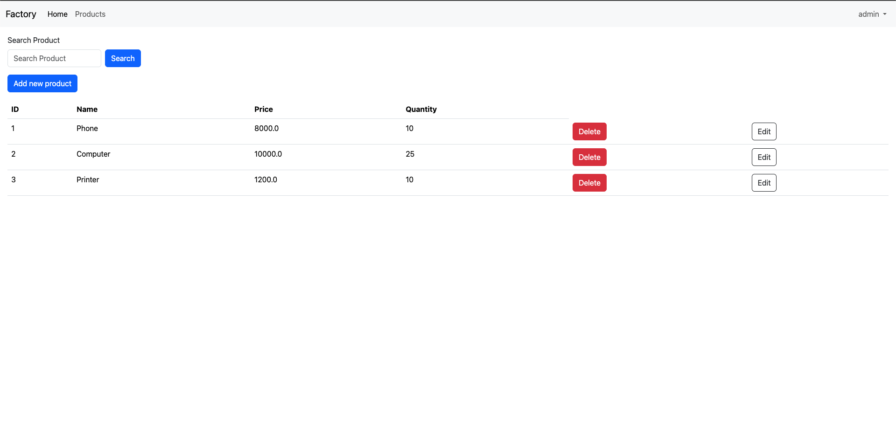
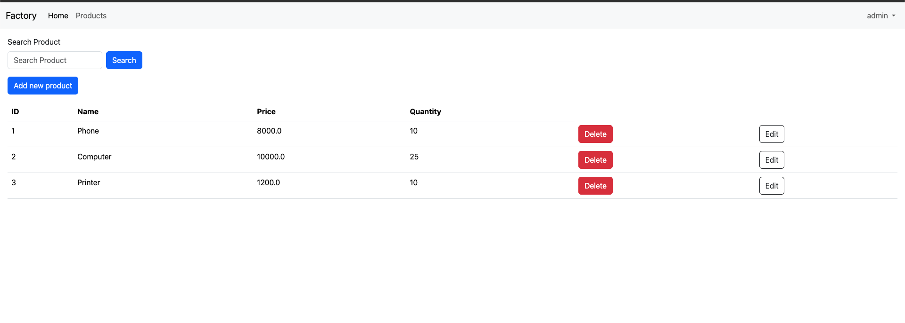
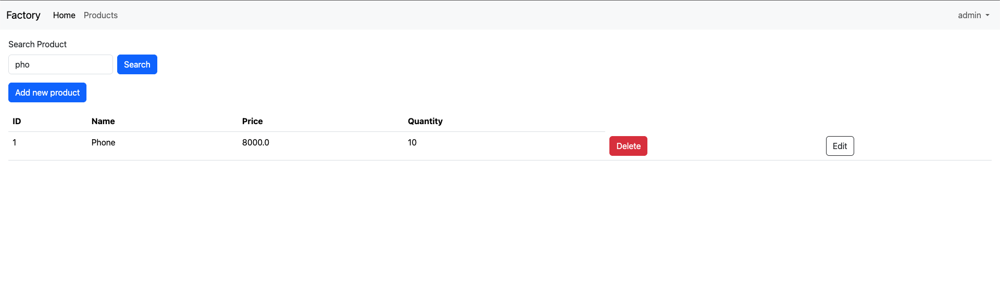
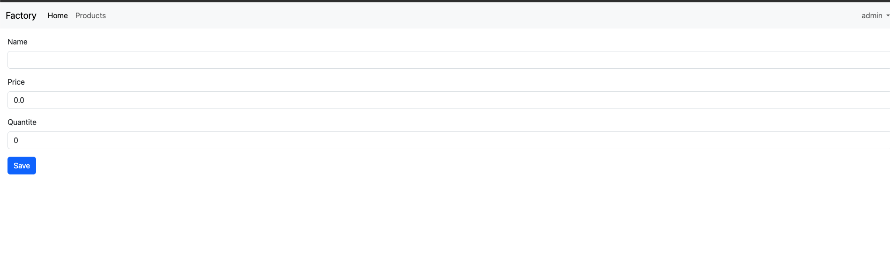
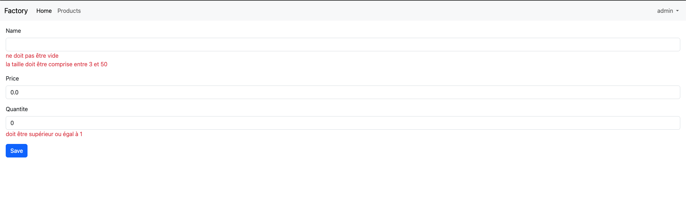
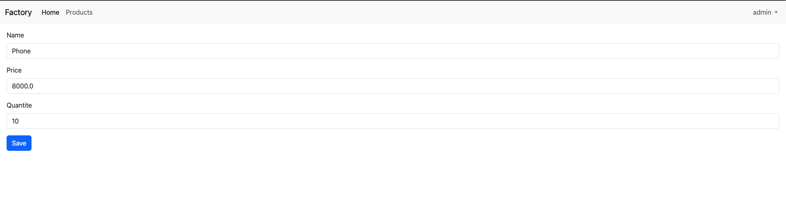
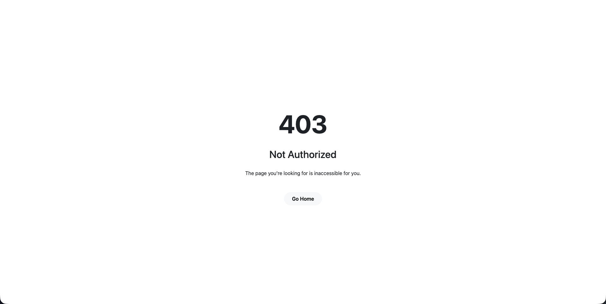

# Spring MVC Thymeleaf : Gestion de produits

Application web de gestion de produits développée avec **Spring Boot**, **Spring MVC**, **Thymeleaf** et **Spring Security**. Elle permet de consulter, rechercher, ajouter, modifier et supprimer des produits, avec une gestion des accès selon le rôle de l'utilisateur (`USER` ou `ADMIN`).



---

## Table des matières

1. [Fonctionnalités](#fonctionnalités)
2. [Aperçu](#aperçu)
3. [Technologies utilisées](#technologies-utilisées)
4. [Architecture du projet](#architecture-du-projet)
5. [Prérequis](#prérequis)
6. [Installation et lancement](#installation-et-lancement)
7. [Configuration (variables d'environnement)](#configuration-variables-denvironnement)
8. [Sécurité et rôles](#sécurité-et-rôles)
9. [Routes de l'application](#routes-de-lapplication)
10. [Validation des données](#validation-des-données)
11. [Améliorations possibles](#améliorations-possibles)
12. [Auteur](#auteur)

---

## Fonctionnalités

- Authentification avec une **page de login personnalisée**
- Gestion des rôles : `USER` et `ADMIN`
- Affichage de la liste des produits
- **Recherche** de produits par nom (insensible à la casse)
- **Ajout** d'un produit (réservé aux administrateurs)
- **Modification** d'un produit existant (réservé aux administrateurs)
- **Suppression** d'un produit (réservé aux administrateurs)
- **Validation** des formulaires avec affichage des messages d'erreur
- Page personnalisée **« Accès refusé »**
- Interface responsive avec **Bootstrap**
- Layout commun avec **Thymeleaf Layout Dialect**

---

## Aperçu

### Page de connexion


### Liste des produits



### Recherche d'un produit



### Ajout d'un produit



### Validation du formulaire



### Modification d'un produit



### Accès refusé



---

## Technologies utilisées

| Technologie | Rôle |
|---|---|
| Java 17+ | Langage |
| Spring Boot | Framework principal |
| Spring MVC | Couche web (contrôleurs) |
| Spring Data JPA | Accès aux données |
| Spring Security | Authentification et autorisation |
| Thymeleaf + Thymeleaf Extras Spring Security | Moteur de templates |
| Thymeleaf Layout Dialect | Mise en page commune |
| Bootstrap (WebJars) | Interface utilisateur |
| Jakarta Bean Validation | Validation des formulaires |
| Maven | Gestion des dépendances |
| Base de données | À préciser (H2, MySQL, PostgreSQL...) |

---

## Architecture du projet

```
src/
├── main/
│   ├── java/dev/anwarelouardini/springmvcthymeleaf/
│   │   ├── SpringMvcThymeleafApplication.java
│   │   ├── entities/
│   │   │   └── Product.java
│   │   ├── repositories/
│   │   │   └── ProductRepository.java
│   │   ├── sec/
│   │   │   └── SecurityConfig.java
│   │   └── web/
│   │       └── ProductController.java
│   └── resources/
│       └── static
│       ├── application.properties
│       └── templates/
│           ├── layout1.html
│           ├── login.html
│           ├── products.html
│           ├── new-product.html
│           └── not-authorized.html
└── test/
```
---

## Prérequis

- **JDK 17** ou supérieur
- **Maven 3.8+** (ou le wrapper `mvnw` fourni)
- Une base de données (si tu n'utilises pas H2)
- Un IDE (IntelliJ IDEA recommandé)

---

## Installation et lancement

### 1. Cloner le dépôt

```bash
git clone https://github.com/anwarelouardini/Spring-MVC-Thymeleaf.git
cd Spring-MVC-Thymeleaf
```

### 2. Configurer les variables d'environnement

Voir la section [Configuration](#configuration-variables-denvironnement).

### 3. Lancer l'application

Avec Maven :

```bash
./mvnw spring-boot:run
```

Ou depuis **IntelliJ IDEA** : ouvre la classe principale et clique sur **Run**.

### 4. Accéder à l'application

Ouvre [http://localhost:9001](http://localhost:9001) dans ton navigateur.

---

## Configuration (variables d'environnement)

Les informations sensibles ne sont pas écrites en dur dans le code. Elles sont lues depuis des variables d'environnement.

### Exemple dans `application.properties`

```properties
server.port=9001

spring.datasource.url=${DB_URL}
spring.datasource.username=${DB_USER}
spring.datasource.password=${DB_PASSWORD}

spring.jpa.hibernate.ddl-auto=update
spring.jpa.show-sql=true
```

### Variables à définir

| Variable | Description | Exemple |
|---|---|---|
| `DB_URL` | URL de la base de données | `jdbc:postgresql://localhost:5432/mabase` |
| `DB_USER` | Utilisateur de la base | `admin` |
| `DB_PASSWORD` | Mot de passe de la base | `secret` |

### Dans IntelliJ IDEA

1. **Run > Edit Configurations...**
2. Sélectionne la configuration Spring Boot.
3. Dans **Environment variables**, ajoute :

```
DB_URL=jdbc:postgresql://localhost:5432/mabase;DB_USER=admin;DB_PASSWORD=secret
```

### Dans le terminal

```bash
export DB_URL=jdbc:postgresql://localhost:5432/mabase
export DB_USER=admin
export DB_PASSWORD=secret
./mvnw spring-boot:run
```

> Ne commite jamais de fichier `.env` ou de mots de passe. Ajoute `.env` à ton `.gitignore`.

---

## Sécurité et rôles

L'application utilise **Spring Security** avec une page de connexion personnalisée (`/login`).

| Rôle | Droits |
|---|---|
| `USER` | Consulter et rechercher les produits |
| `ADMIN` | Tout ce que fait `USER` + ajouter, modifier et supprimer des produits |

### Configuration de la chaîne de sécurité

```java
        return http
        .formLogin(fl -> fl.loginPage("/login").permitAll())
        .authorizeHttpRequests(ar -> ar.requestMatchers("/user/**").hasRole("USER"))
        .authorizeHttpRequests(ar -> ar.requestMatchers("/admin/**").hasRole("ADMIN"))
        .authorizeHttpRequests(ar->ar.requestMatchers("/public/**", "/webjars/**", "/notAuthorized").permitAll())
        .authorizeHttpRequests(ar->ar.anyRequest().authenticated())
        .exceptionHandling(eh -> eh.accessDeniedPage("/notAuthorized"))
        .build();
```

### Comptes de démonstration

| Utilisateur | Mot de passe | Rôle |
|---|---|---|
| `user1` | `1234` | USER |
 | `user2`| `1234`| USER|
| `admin` | `1234` | ADMIN |

---

## Routes de l'application

| Méthode | URL | Rôle requis | Description |
|---|---|---|---|
| GET | `/` | Connecté | Redirige vers `/user/index` |
| GET | `/login` | Public | Page de connexion |
| GET | `/user/index` | USER / ADMIN | Liste des produits |
| GET | `/user/searchProducts?productName=...` | USER / ADMIN | Recherche de produits |
| GET | `/admin/addProduct` | ADMIN | Formulaire d'ajout |
| POST | `/admin/saveProduct` | ADMIN | Enregistre (création ou modification) |
| POST | `/admin/update?id=...` | ADMIN | Formulaire de modification |
| POST | `/admin/delete?id=...` | ADMIN | Supprime un produit |
| GET | `/notAuthorized` | Public | Page d'accès refusé |

---

## Validation des données

L'entité `Product` utilise Jakarta Bean Validation :

```java
@Entity
@Getter @Setter @NoArgsConstructor @AllArgsConstructor @ToString @Builder
public class Product {
    @Id @GeneratedValue(strategy = GenerationType.IDENTITY)
    private Long id;
    @NotEmpty @Size(min = 3, max = 50)
    private String name;
    @Min(0)
    private double price;
    @Min(1)
    private int quantity;
}
```

Les erreurs sont affichées sous chaque champ du formulaire grâce à `th:errors`.

---

## Améliorations possibles

- [ ] Pagination de la liste des produits
- [ ] Messages de confirmation après sauvegarde ou suppression
- [ ] Confirmation avant suppression
- [ ] Gestion des catégories de produits
- [ ] Tests unitaires et d'intégration
- [ ] Déploiement avec Docker

---

## Auteur

**Anwar El Ouardini**

- GitHub : [@anwarelouardini](https://github.com/anwarelouardini)
- LinkedIn : [anwarelouardini](https://www.linkedin.com/in/anwarelouardini/)